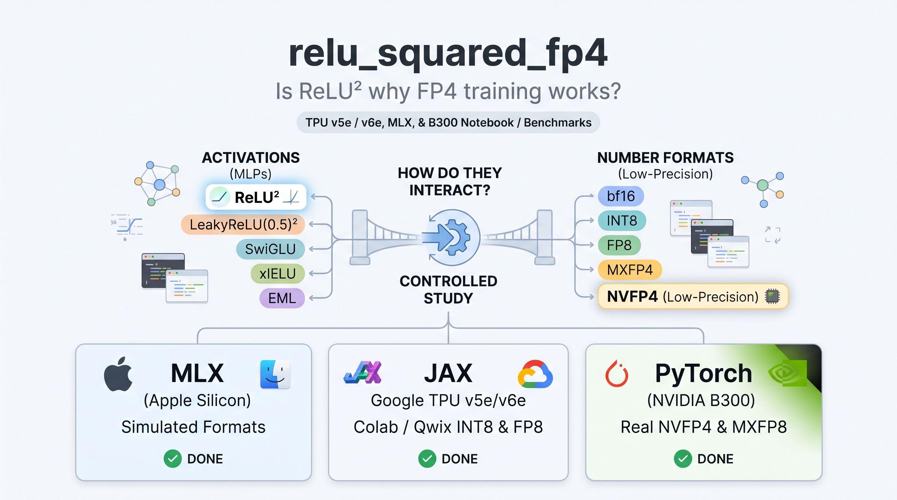

# relu_squared_fp4

[](https://colab.research.google.com/github/atveit/relu_squared_fp4/blob/main/jax_tpu/colab_tpu.ipynb) (TPU v5e / v6e notebook)



**Is ReLU² why FP4 training works?** This is a small, controlled study of how the MLP activation interacts with the number format in low-precision LLM training.

> ⚠️ **Work in progress.** The Mac (MLX, simulated formats) results are in. The TPU (Colab) and B300 (real NVFP4) runs are pending, and the JAX and PyTorch trainers are still being smoke-tested.

## The question
- **Why I'm asking:** several large FP4 and FP8 training runs use squared ReLU in the MLP, but I found no controlled study of whether the activation decides if a low-precision format trains well, or whether the best activation changes with the format.
- **The design:** this repo trains the *same* small GPT, with the same optimizer, on the same tokens on three platforms, and varies only two factors:
  - **Activation:** ReLU², LeakyReLU(0.5)² (from OpenAI's parameter-golf records), SwiGLU, xIELU, a gated ReLU², a bounded EML-gated ReLU², and EML.
  - **Number format:** bf16, INT8, FP8, MXFP4 and NVFP4.
    - FP8 and INT8 run as fake-quant everywhere, and as real INT8 on TPU via Qwix.
    - MXFP4 and NVFP4 run as fake-quant everywhere, and as real NVFP4 / MXFP8 on B300 via Transformer Engine.

## Platforms and status

| Platform | Code | Formats | Status |
|---|---|---|---|
| Mac (Apple Silicon, MLX) | `mlx_mac/` (`train_mlx.py`, `lowp.py`, `lowp_grid.py`, plus the custom Metal kernels in `eml_kernels.py`) | simulated, all formats | **done:** `mlx_mac/results/lowp_A.jsonl` |
| Google TPU v5e / v6e (Colab) | `jax_tpu/train_jax.py` (Flax NNX + optax + Qwix) | real INT8; simulated FP8 / FP4 | being fixed and smoke-tested; Colab notebook coming |
| NVIDIA B300 (RunPod) | `torch_b300/` (PyTorch + Transformer Engine) | real NVFP4 and MXFP8; simulated formats | being smoke-tested on H100 first |

## Repository layout
```
common/       shared model and optimizer config (config.py) and data loader (data.py); every platform imports these
mlx_mac/      Apple Silicon trainer (MLX + Metal kernels) and the Mac grid runner (lowp_grid.py, stage1.py)
jax_tpu/      JAX / Flax NNX trainer for TPUs (train_jax.py), Colab notebook (colab_tpu.ipynb)
torch_b300/   PyTorch + Transformer Engine trainer for Blackwell (train.py, model.py, optim.py, quant_sim.py, grid.py)
results/      per-platform result files (JSON lines, one record per run)
analysis/     scripts that compare platforms and make the figures
data/         FineWeb shards, downloaded on first use (gitignored)
```

## Shared settings
- **One source of truth:** `common/config.py` holds the model configs (`tiny`: d = 256, 4 layers, 512 context, 16k tokens per step; `gpt2s`: GPT-2-small shape), the activations, and the optimizer (Muon on 2-D block matrices, Adam elsewhere). The trainers mirror the MLX reference.
- **Data:** `common/data.py` reads modded-nanogpt's GPT-2-tokenized FineWeb shards (`kjj0/fineweb10B-gpt2` on Hugging Face, downloaded on first use into `data/`).

## How to run (more detail as the trainers are verified)
```bash
# Mac (MLX): the full simulated grid; resumable, and runs 2 jobs at a time
FP4_DATA=$PWD/data python3 -m mlx_mac.lowp_grid run && python3 -m mlx_mac.lowp_grid report
# JAX (CPU smoke test; TPU on Colab: see jax_tpu/README_COLAB.md once added)
FP4_PLATFORM=cpu JAX_PLATFORMS=cpu python jax_tpu/train_jax.py --act relu2 --recipe bf16 --steps 3 --batch 4 --val-tokens 16384
# PyTorch (GPU)
python torch_b300/train.py --help
```

## Credits
- [modded-nanogpt](https://github.com/KellerJordan/modded-nanogpt), for the tokenized FineWeb data and the ReLU² speedrun setting.
- OpenAI's parameter golf, for LeakyReLU(0.5)² (abaybektursun, 2026-03-23).
- Google's [Qwix](https://github.com/google/qwix), for TPU quantization, and NVIDIA's [Transformer Engine](https://github.com/NVIDIA/TransformerEngine), for real FP4 / FP8 on Blackwell.

Apache-2.0 (see `LICENSE`). Author: Amund Tveit.
